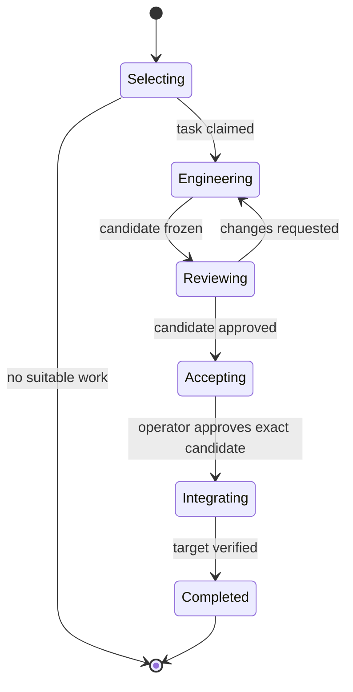

# Concoct implementation design

Revision 0.5 · 2026-10-12 · Accepted design · Fresh active source tree and manual construction agreed

This design implements the accepted operating baseline: one responsible engineer agent selects and completes one task, an independent reviewer assesses the candidate, and the operator approves its integration. Source code remains the evidence of implemented behavior. Durable records preserve active work and the decisions needed to finish it.

This is a design deliverable, not an implementation or the task-3 implementation roadmap. Existing failed sessions need not migrate. The baseline's section-5 archive scope is treated as accepted, including the option to omit agent archive access initially.

**Review status:** the operator accepts the design and its three proposals. The supplied final runtime report establishes the required configuration and stop/resume mechanisms on Codex 0.147.0 for the first implementation scope; these mechanisms still need integration and verification in Concoct. The initial runner uses the operator's trusted full-access model; tool confinement/management is outside this first scope. This supersedes the earlier requirement to demonstrate filesystem-enforced archive exclusion. Archive use remains restricted by workflow instructions and context selection. Task 3 defines the implementation backlog. CON-043 specifies resetting a branch from main to a clean buildable baseline before rebuilding; the old source is harvesting reference only. Construction is manually operated through Codex sessions, with no existing Concoct skill or self-hosting requirement.

## 1. Inputs and confidence

| Input | Use in this design |
| --- | --- |
| Operating-model baseline draft 0.3 and subsequent acceptance | Product behavior and accepted policies |
| `concoct-runner-capability-assessment.md` | Existing implementation gaps and reusable mechanics |
| `upload/concoct-runtime-verification.md` | Reported results from Codex 0.147.0 on the operator's Linux installation |
| `upload/concoct-runtime-followup-verification.md` | Continuing-turn callbacks, partial native-tool coverage and observed post-interruption execution |
| `upload/concoct-final-runtime-verification.md` | Explicit full-access resume, background-terminal cleanup, verified process cessation and no-replay continuation |
| Supplied `concoct-con-042.zip`, HEAD `a3e1dcf314a3b988364b9b1b262dd3a24c1bd3d1` | Source-level assessment of reuse |

The runtime report supports local app-server transport, separate persistent role threads, exact-thread resume across server restarts, commentary, model discovery, quota snapshots, token receipts, and command-execution confinement. It also demonstrates resuming iragent against a revised candidate. These are reported installation results; raw probe logs were not independently inspected here. They do not prove Concoct's new end-to-end workflow or compatibility with other runner versions.

The follow-up resolves continuing-turn callbacks and tool restoration after exact-thread restart/resume on the installed version. Native file-tool confinement remains unresolved: allowed image reads occurred, but claimed denied image/patch attempts had no corresponding tool events. A running command's heartbeat advanced after provider interruption while app-server remained alive. The harness also confused sandbox namespace PIDs with host PIDs, so it did not establish the full process tree or eventual provider-driven termination. Safe continuation was correctly withheld.

Under the accepted full-access model, the native-tool confinement check is retired rather than reported as passed. The final report confirms explicit role settings at start, full-access reagent resume with explicit reapplication, and actual process cessation followed by same-thread continuation without command replay. This closes the runtime capability investigation needed for the first implementation scope. No tool inventory, deny-path matrix or further broad capability trial is needed. These are report-based findings; raw probe logs were not independently inspected here.

Two model turns were used in the final probe and repository source remained unchanged. Iragent/high settings were accepted by metadata start, but high-effort inference and persisted reviewer/high resume were not exercised in that two-turn trial. Host-signal fallback was not tested because provider terminal cleanup succeeded. Verify those paths proportionately during implementation/the first real review; they do not require reopening this general investigation. The catalog default is the installed runner's reported recommendation, not independent proof of the newest global model release.

## 2. Small execution architecture

Use one foreground Go binary and a local Codex app-server process over stdio. Persistent role threads survive across CLI invocations; an always-running Concoct daemon is unnecessary for this scope.

| Component | Responsibility |
| --- | --- |
| Run controller | Resume-before-selection, dispatch policy, role routing, counters, operator decisions, stop/recovery |
| Codex client | Handshake, capability/model discovery, thread/turn lifecycle, host callbacks, commentary and usage events |
| Active-work store | Atomic checkpoints, minimal execution metadata, execution lock, archive/retention |
| Git operations | Isolated workspace, exact candidate capture, review checkout, approval binding, integration/reconciliation |
| Presentation and profiles | Human-readable progress/status, CLI results, automatic role instructions and effective settings |

These are code responsibilities, not separate services. Start with explicit functions and types for this workflow; avoid a generic orchestration framework, persona graph, event broker, or replicated product inventory.

The binary performs consequential bookkeeping and deterministic checks. Reagent does normal engineering, command discovery, validation, self-review and documentation in a continuous turn. Iragent reviews independently. Neither role returns control merely to mark planning, implementation or self-review complete.

## 3. Selection without a planning handoff

On `concoct run`, first inspect the repository binding and active work. If active work exists, reconcile and resume its pending activity, or return its existing intervention. Never select another task around a blocked or stopped active task.

With no active task, use the current named branch as the **parent branch** and eventual integration destination. Require its checkout to be clean, capture its name and baseline revision, and prepare an isolated run workspace. The operator need not create or select a new task branch. A dirty checkout with no active work is a prerequisite error: report the branch and relevant changes, make no product edits, and do not start a selection turn. A detached HEAD likewise needs an identified parent branch before new work. Active work is considered first; an unfinished active engineering checkout is expected to contain changes and is not rejected by this new-work check.

Supply reagent with the current roadmap, source, applicable repository instructions and automatic role profile. It examines readiness, priority, dependencies, scope and acceptance, selects exactly one task, then **creates that task's branch from the captured parent baseline** within the same turn. Concoct validates and records the binding through `claim_task`; reagent continues engineering after successful acknowledgment. Epics and features remain organizational entries.

Distinguish the parent branch, reagent-created task branch and frozen candidate commit in metadata and output. Use an external task checkout, such as a Git worktree at the captured baseline, to separate unfinished source from the parent checkout. This is working-state separation, not a filesystem security boundary. Reagent creates its task branch and performs ordinary Git work there; its instructions prohibit advancing the parent before approval. Concoct checks parent/candidate identities before consequential operations. No private clone or ref-level permission system is required for the initial full-access model, and branch creation does not need its own agent turn.

Use two narrow host operations, callable within an agent turn:

| Operation | Contract |
| --- | --- |
| `claim_task` | After selecting a task and creating its branch, reagent supplies its task ID/branch and selection rationale. Concoct takes objective and acceptance prose from that roadmap entry, validates the mechanical task and branch binding, and records initial `task.md`; success lets reagent continue immediately. |
| `save_checkpoint` | The current role supplies its current checkpoint. Concoct atomically updates only that role's permitted content in `task.md` or the pending review record. It does not authorize scope changes or produce a candidate approval. |

The [documented app-server dynamic-tool interface](https://developers.openai.com/codex/app-server#dynamic-tool-calls-experimental) is experimental. The follow-up observed successful claim → edit → checkpoint → completion in one turn, and a restored checkpoint tool after restart/resume without redeclaration. This supports the proposed bridge on Codex 0.147.0. Validate supported installed versions/schemas rather than assuming all versions behave identically.

`claim_task` checks valid unique identity, task kind, ready status, known references, declared completed dependencies, no active assignment, unchanged parent baseline, task branch at that baseline and absence of implementation edits before claiming. Creating the task branch is permitted before the claim; source/index contents remain unchanged until acknowledgment. The check does not attempt to prove semantic readiness by duplicating reagent's judgment. Reagent explains why higher-priority entries are unsuitable; a material departure needs an operator decision. A violated claim is rejected and cannot become an accepted candidate.

Claim and checkpoint requests are bound to the recorded role, thread and turn. Persist a response receipt before returning it; replay of the same request returns the same receipt without repeating a branch change or checkpoint. A second different task claim is rejected. These receipts are bounded execution facts, not a general agent conversation ledger.

The follow-up's first attempt committed host fixture writes but returned an invalid callback response. Subsequent retries had new call IDs and the agent still edited its fixture. Validate the response shape before mutation: the installed response uses `success`, `contentItems` and text type `inputText`. Durable host mutation and provider acceptance are distinct observations. Reconcile an uncertain reply against the existing binding; a new call ID must not create a second claim. Engineering requires an acknowledged valid claim, and an unresolved mandatory callback prevents candidate readiness from being accepted even if the provider turn completes.

If selection finds no suitable work, reagent reports what it inspected and the concrete impediment. A missing material decision becomes a focused question; otherwise this is normal no-work. No product edits or fabricated tasks are permitted. Selection still consumes provider usage and a bounded dispatch allowance, including when no task is selected.

### Roadmap mechanics

Keep the roadmap as readable Markdown. A thin supported metadata convention supplies `ID`, `Kind`, `Status`, `Priority`, optional `Parent`, and `Depends-on`; objective and acceptance remain normal prose. `Parent` and dependency relationships are distinct. Completed IDs can be resolved through the roadmap and concise `capabilities.md` entries, without reading archived narratives.

The parser recognizes metadata and references; it does not choose work. Unsupported or contradictory metadata produces a precise preflight diagnostic rather than an agent retry loop. Preserve any existing project convention that satisfies this contract; a particular syntax should be fixed with the implementation tests, without rewriting prose into a second ledger.

## 4. Durable active work

Use **`$HOME/.concoct/` as the default external, user-owned durable root**, with repository state under `$HOME/.concoct/repos/<repository-id>/` and user configuration in the same root. A single explicit root override can relocate it; XDG variables do not implicitly split or relocate Concoct's records. Store active workspaces here rather than in a disposable cache. Repository identity includes the canonical original Git common directory; a task records the parent branch/baseline and reagent-created task branch separately. Concoct supplies paths for only the current workspace/evidence. Under full access this is context selection, not a claim that other paths are inaccessible.

| Record | Contents and owner |
| --- | --- |
| `runs/<run-id>/state.json` | Small versioned record: bindings, phase/hold, effective role settings, thread/turn IDs, candidate/review identities, counters, pending operation/request, approval and recovery facts. Concoct owns it. |
| `runs/<run-id>/evidence/task.md` | Objective, exclusions, acceptance, selection rationale, current engineering checkpoint, command sources/results, self-review summary, decisions, answers, blocker and next action. |
| `runs/<run-id>/evidence/review-NN.md` | One iragent assessment of one exact candidate, including findings, resolution checks and verdict. Iragent owns its content. |
| `workspaces/<run-id>/` | External task checkout/worktree, reagent-created task branch and separately pinned review checkout. Git owns source history; no source inventory is copied into task records. |
| `archive/<task-id>/<completion-id>/` | Final task/reviews and compact completion facts, excluded from automatic agent context and routine lookup. Full access does not physically deny reads. |

Before claiming a task, the run record holds selection/recovery facts but no invented task. Only one run may own active work for a repository. Deferred work releases that binding and remains explicitly resumable; it must not become ordinary historical input to a different task.

Use `task.md` as the sole human engineering record; no `notes.md`. Concoct protects the agreed objective/acceptance and appends operator decisions. Reagent updates current plan, evidence and next action through the checkpoint operation. Authorized scope revisions replace the agreed scope while preserving the material decision. The iragent host operation rejects edits to reagent's engineering checkpoint; role instructions also prohibit direct edits. These are not host-filesystem access restrictions. The JSON record stores operational bindings and counters, not a duplicate task narrative.

A checkpoint occurs after selection, material plan/decision changes, meaningful implementation or verification progress, and before a normal return or intervention. On interruption the last checkpoint plus actual workspace are retained; do not imply an interrupted agent produced a final summary. A replacement session receives the current task and its active reviews, then inspects the source to reconcile incomplete work.

Write records using temporary file, file sync, atomic rename and directory sync. For a transition involving multiple files, persist a small pending operation with expected revisions/digests and reconcile it on reopen. Avoid an event-sourced history of every message. Optional bounded diagnostic logs are separate and are never automatic resume context.

An execution lock prevents concurrent `run` mutation. `status` reads atomic snapshots without acquiring that exclusive lock, invoking an agent or changing the records. It shows the observation timestamp and can identify an apparently lost owner; only `run` performs recovery.

## 5. Execution phase, holds and role results

Persist a phase and an optional hold separately. A question, authorization wait, exhausted limit, environment problem or uncertain interruption suspends the existing phase; it does not create a new task or reset counters.

Each agent returns one schema-defined JSON result with a disposition, human summary and, where relevant, task ID, candidate ID, findings or an explicit operator question. Concoct validates the shape and any supplied identity against the active binding. It preserves summaries and findings as agent narrative without inferring engineering success from their wording. Task/review prose remains in the evidence files.

| Role result | Controller action |
| --- | --- |
| Reagent: ready for independent review | Verify the completed turn, task binding, checkpoint and idle source; freeze candidate and start iragent under dispatch policy |
| Reagent: no suitable work | Return normal no-work, only during selection |
| Either: needs input | Persist blocker and requesting role; stop until an answer supplies actionable input |
| Either: unable within bounds | Preserve evidence and report consumed allowance and unresolved work |
| Iragent: changes requested | Finalize assessment, route findings to existing reagent, then reassess the revised candidate |
| Iragent: approved | Finalize assessment and present exact candidate for operator acceptance |

**Display agent progress and responses as they arrive throughout the turn.** Do not wait for completion or result validation to print them. Agent statements such as “implementation complete” may be displayed immediately as agent-reported progress; they do not by themselves authorize Concoct to advance the execution phase.

For a state transition such as freezing a candidate or accepting a review verdict, Concoct requires the provider's completed-turn receipt, the valid role disposition and its mechanical prerequisites. These checks govern state transitions, not the stream of terminal output. Provider completion alone is not an engineering verdict. Missing/malformed results permit a bounded clarification turn when safe; they never imply approval. Provider failure, disconnection and interruption are execution outcomes, not invented agent verdicts.

Under the initial dispatch policy, readiness flows directly into independent review, and findings flow directly into correction. **There is no first-iragent authorization gate.** The CLI returns readiness separately only when a configured policy pauses review; it displays both candidate readiness and the missing authorization.

## 6. Candidate preparation, validation and review continuity

Reagent implements, discovers established project checks, validates and self-reviews within its candidate cycle. The checkpoint records the reagent’s work, checks, self-review and next action in its own words. Reagent judges task suitability, criterion coverage, check sufficiency, documentation and unresolved findings. Concoct passes this narrative through without matching it against acceptance bullets or command strings. Routine failed tests stay with reagent.

Before returning readiness, reagent reconciles `roadmap.md` and `capabilities.md` in the proposed source changes, preserving original task IDs. These edits describe the state that integration would deliver. They remain isolated candidate changes until approval and are reviewed with the implementation.

Concoct freezes a candidate only after a normal ready result, completed turn and confirmed quiescence of its tool processes. It captures baseline revision/tree, candidate revision/tree, binary diff digest and changed paths. Reagent can create commits on its task branch as ordinary engineering. Concoct verifies the branch/baseline and records an immutable candidate; if a final commit is still needed, it can perform that mechanical operation without a commit-only agent turn. Parent integration remains an explicit operator-authorized action; full access does not physically prevent an agent from violating that instruction. Build outputs may be excluded under an explicit project policy, but untracked deliverable source cannot be silently omitted. Candidate evidence binds the verified source contents; creating a commit with identical contents does not manufacture a need to rerun unchanged tests.

Iragent has a different thread and a source checkout pinned to that candidate, plus the current task and active assessments. Its role is read-only with respect to candidate source; this is an instruction under full access, not a special filesystem profile. Concoct verifies that candidate identity/content did not change during review. Iragent returns a structured verdict with a human summary and specific findings for requested changes. Concoct writes that result into candidate-bound review evidence. The optional assessment callback retains in-turn findings when an operator question about source changes needs them; finalized assessments cannot be edited through it. Each verdict binds the candidate identity and agreed task revision. Approval of an older candidate never approves a later one.

When changes are requested, resume reagent with the findings. When its next candidate is ready, update the review checkout only after the previous review execution is demonstrably idle, then resume the same iragent thread with the exact revised identity and correction evidence. Session identity is not candidate identity: moving the review checkout is allowed; moving the candidate during an active assessment is not. An interrupted assessment keeps its number and pending state. A completed new assessment receives the next number.

Fresh iragent is a recovery or explicit policy choice, not the default for another review cycle. It receives active evidence only. Never reuse either role's thread for a different task.

## 7. Operator commands and interventions

These commands are proposed syntax, not current binary behavior. Every returned intervention includes its exact continuation command and relevant IDs, so the operator need not relay prompts.

| Command | Behavior |
| --- | --- |
| `concoct run` | Resume active work; otherwise select one task and proceed within the initial grant |
| `concoct status [TASK] [--json]` | Read-only task/phase/candidate/progress/usage/limits/pending-action snapshot |
| `concoct run --answer QUESTION --text TEXT` | Durably answer the pending question, then resume under dispatch policy |
| `concoct run --answer QUESTION --choice OPTION` | Same, using a displayed stable option ID |
| `concoct run --answer QUESTION --answer-file PATH` | Same, with a longer decision or action evidence |
| `concoct run --authorize DISPATCH` | Explicitly authorize the displayed pending dispatch, if policy requires it |
| `concoct run --approve ACCEPTANCE` | Approve the displayed exact candidate/target binding and integrate if still valid |
| `concoct run --extend TASK --review-limit N` | Raise the relevant limit without erasing consumption; analogous flags cover other limits |
| `concoct run --defer TASK --reason TEXT` | Preserve resumable work and release active ownership |
| `concoct run --abandon TASK --reason TEXT` | Preserve terminal disposition and release ownership without integrating |
| `concoct run --resume TASK` | Explicitly reactivate deferred work when no other task owns the repository |

Ctrl-C requests graceful provider interruption in the foreground process. Do not add a daemon solely to support a second-process stop command. If cancellation cannot establish quiescence, report abnormal stop and retain uncertainty rather than claiming a safe stop. Defer/abandon are allowed only after execution is idle.

A blocker includes requesting role, blocked objective, evidence/attempts, exact missing input or action, options/tradeoffs if useful, safe remaining work and next step. The operator can provide free text or external-action evidence. Persist the answer before dispatch; resume the requesting role by default. If an iragent answer requires source changes, route to reagent, then reassess the resulting candidate. Relevant decisions reach both roles automatically. An answer neither supplies an unrelated budget grant nor proves an external blocker is resolved; the agent verifies the actual condition.

Human output includes role commentary, phase transitions, check outcomes, candidate identity, effective model/effort, consumption and actionable next commands. Do not expose raw reasoning or drown status in tool dumps. Support quiet and JSON modes; return dispositions remain available even when ordinary progress is suppressed.

Commentary and human-readable responses are streamed during execution, including while work remains incomplete. Emit final Concoct status separately, distinguishing what the agent reported from what the controller has verified. Ordinary output is never delayed merely to wait for a terminal receipt.

Use stable named dispositions in JSON: `completed`, `ready_for_acceptance`, `decision_required`, `authorization_required`, `no_suitable_work`, `prerequisite_error`, `stopped_safely`, `stopped_abnormally`, `deferred`, `abandoned`, and `busy`. Configured review pauses also include `ready_for_independent_review` as the pending activity. Assign documented distinct exit codes for actionable non-completion dispositions; exact numeric assignments are a CLI implementation detail, not an agent contract.

## 8. Dispatch policy, bounds and allocation

Before every turn that starts agent work, resolve authorization, effective settings, remaining allowances, available quota and resume safety. Persist dispatch intent and reserve its attempt before making the provider request. A dispatch with an uncertain acknowledgement still consumes an attempt; querying metadata, saving checkpoints and mechanically integrating do not consume agent dispatches.

The first `run` grants automatic selection, engineering, review and correction within the recorded task policy. Optional gates can require authorization at any dispatch. Plain `run` does not satisfy an already pending explicit gate. Fresh-run `--turn-timeout` and `--stall-timeout` set retained elapsed and inactivity limits; exceeding either cancels the turn and invokes owned-process cessation before continuation. Approval to integrate is separate from all agent budget grants.

| Bound | Starting policy |
| --- | --- |
| Reagent self-review | Accepted: at most 3 passes per candidate preparation cycle; instruction-based inside the turn |
| Iragent assessments | Accepted: at most 3 completed assessments per task, including the first |
| Recovery | Accepted: at most 2 attempts per failure episode; also subject to total dispatch bound |
| Agent dispatch attempts | Accepted: 12 per run/task, including initial selection, continuations and recovery |
| Elapsed/stall watchdog | Optional and disabled by default; no short timeout inferred from typical engineering duration |
| Allocation warning/gate/interruption | Configurable thresholds and fallback; no fabricated hard spend ceiling |

The first selection attempt belongs to the run and transfers into its task consumption on claim. Repeated unclaimed selection attempts remain bounded. A fresh invocation never refreshes that run's counters. A new correction cycle can have a new inner self-review allowance, while task review/dispatch counters continue accumulating. Returning from a blocker does not create an assessment or reset its allowance. Raising a limit changes the ceiling and retains the consumed count.

The accepted 12-dispatch default is a conservative tuning choice, not a measured optimum. Self-review instructions are not hard runtime ceilings; a dispatch cap cannot stop a single turn that never yields. Optional elapsed/stall/allocation interruption addresses that case, with the cancellation limitations stated. Do not turn every self-review pass into a provider handoff to count it mechanically.

Allow project defaults and explicit task overrides for each bound. Resolve and retain them when the run/task is created; later changes use explicit extensions or policy revisions rather than rereading configuration to refresh consumption.

Sample account quota before/after dispatch and consume supported updates. Show each window's used/remaining percentage, reset time and observation age. Store token receipts separately. The runtime report's 300-minute and 10,080-minute windows describe that installation, not hard-coded product assumptions. Tokens are not subscription quota percentages or dollar charges. Account changes may include other sessions and rounding; resets/window changes prevent simple subtraction. Missing or stale telemetry is explicitly unknown.

Initial behavior reports available quota and usage without making exact task-spend claims. Configured policy can warn, hold the next dispatch or request interruption at thresholds; it must explain delayed observations and overshoot. Default unavailable-telemetry behavior continues within iteration bounds while showing unknown. Strict budget policy can instead require authorization. Fine-grained live allocation enforcement is not required to demonstrate the golden path.

## 9. Role profiles and model selection

Supply reusable reagent and iragent instructions automatically. They cover task selection/engineering versus independent review, checkpoint/blocker/result contracts, source-of-truth rules, boundaries and limits. Keep shared rules shared; do not make the operator paste personas.

Resolve explicit invocation flags first, then configured project role defaults, then Concoct's role defaults. For new tasks, use the latest provider-recommended default model exposed by the runner, with reagent medium and iragent high where supported. Optional user-wide Concoct defaults may be explicitly configured below project defaults; unrelated ambient Codex/VSCode settings must not silently replace Concoct's resolved choices. Do not guess the latest model from lexical version names. Resolve the pair explicitly, check supported efforts, display it and persist the effective settings. A catalog entry does not itself prove account entitlement. Unavailable/unsupported settings require a clear choice, not silent substitution or escalation.

Proposed invocation overrides are `--reagent-model`, `--reagent-reasoning`, `--iragent-model` and `--iragent-reasoning`. Keep dispatch policy, bounds and profiles in normal user/project configuration, separate from active evidence. Record their resolved values with the run; configuration changes must not silently reset existing allowances or alter a pending approval.

Resume with recorded settings unless the operator explicitly changes them. Provider recommendations affect new tasks, not existing work. The runtime probe found an effective effort different from the catalog's default; explicitly request the chosen effort and verify the returned effective configuration. Selection, engineering and correction use the same reagent profile/thread. Review uses its separate recorded profile/thread.

Model and reasoning effort are runner settings, not persona-prompt instructions. The operator's VSCode selection controls the investigating session; a separately launched app-server probe has its own explicit settings. Concoct passes its resolved model/effort through supported provider configuration, checks returned settings before starting work, and persists the pair. Do not classify the investigator's selected effort as a prompt-compliance failure. Do not dispatch with a silently mismatched pair.

For the verified 0.147.0 interface: set initial role effort through `thread/start.config.model_reasoning_effort`; explicitly send the recorded model, full-access sandbox and approval policy on **every** `thread/resume`; explicitly send the recorded effort through `turn/start.effort` on every turn. That version's resume schema has no `config.model_reasoning_effort` field. Bare resume of a real persisted thread retained Sol/medium but reverted access to `workspaceWrite` and approval to `on-request`. Therefore model continuity does not establish permission continuity. Verify effective settings and map these parameters through the supported installed schema. The verified full-access configuration is `sandbox: "danger-full-access"` / `approvalPolicy: "never"`; Concoct's own budget and integration authorization policies remain separate.

## 10. Exact approval and integration

After iragent approval, present the source diff, reconciliation, acceptance/verification summary, findings disposition, candidate identity and parent branch as integration destination. Generate an acceptance ID bound to task/scope revision, candidate identity, approving assessment and expected parent baseline. “Target” below means that parent integration destination, not a task branch the operator must prepare. The approval command copies that ID; a task ID alone cannot approve replacement work.

Before integration, verify the approved candidate, matching reviewer approval, expected target revision, clean target checkout and idle execution. If target or candidate changed, invalidate the acceptance and explain the required action. Source changes require appropriate verification and review; an integration-target change must not silently rebase an approved candidate.

Accepted integration is local fast-forward of the parent branch to the reviewed candidate commit, retaining its exact contents and identity. With a worktree the candidate objects already belong to the repository; if a separate repository is used, import and verify the required objects before advancing the guarded parent ref. This deliberately avoids an unreviewed merge result. If fast-forward is no longer possible, return a reconciliation decision rather than using destructive reset or inventing a merge strategy.

Persist integration intent before mutation. The implementation must guard the expected old target ref and reconcile checkout/index/ref state; a simple unchecked `git merge --ff-only` call is not sufficient to promise protection against target races. Concoct serializes its own operations and detects conflicting external changes. Ambiguous ref/checkout outcomes are held for reconciliation, never blindly replayed.

After verifying the target contains the approved candidate and the agreed clean state, mechanically finalize completion, archive evidence and retire active ownership. No agent invocation is needed. Archive/cleanup failure is a maintenance problem after successful integration; show it and retry maintenance, not integration. Publication or deployment is outside this approval.

## 11. Trusted full access, interruption and recovery

The initial runner uses the operator's trusted full-access configuration. Concoct does not introduce a tool allowlist, filesystem-denial profiles, forced disabling of native readers/editors/apps, or a native-tool inventory subsystem. Reagent works on the task branch; iragent inspects the exact candidate and does not edit its source. Role instructions define those responsibilities. Concoct validates its own host operations, task/candidate identities and approvals; it does not claim to contain a misbehaving full-access agent. The operator may choose an external VM/environment boundary independently.

“Permitted native-tool surface” previously meant the set of built-in shell, patch, file/image and plugin paths that would have to respect a restricted filesystem policy. That enforcement objective is not required for the accepted initial operating model. Prior shell-confinement results remain historical evidence; unresolved native-confinement tests are retired, not converted to passes.

Retain archives indefinitely as operator history, outside the product. Do not inject archived task/review/transcript narratives into selection or resume prompts, expose an archive browser, or reuse a previous task's role thread for a new task. Instruct agents to work from source, current project documentation and active evidence, and not browse ungranted archives or request archive access routinely. An operator may explicitly supply named records through normal task input. Under full access this is a workflow/context rule, not filesystem-enforced exclusion. It preserves the objective of avoiding repeated historical rereading without adding tool-management gates. Pruning remains mechanical and excludes active/supplied records still needed by current work.

Persist launch/turn intent, then observed thread/turn identities and terminal receipts. On restart, inspect provider metadata and actual Git/workspace state before another dispatch. A missing acknowledgement does not prove work never ran. Reconcile an observed completion once; resume a safely interrupted role; hold ambiguous execution instead of duplicating work. Repeated recovery is bounded.

The final trial's zero-turn metadata threads returned IDs but could not resume after restart (`no rollout found`). Treat a thread-start receipt as a provisional identity, not proof of durable conversation history. If Concoct knows no turn was dispatched, it may recreate that same-role thread under the retained task/settings. If a turn dispatch is uncertain, absence of a rollout does not establish that no work occurred: retain the intent and reconcile workspace/evidence before replay. Real reagent history resumed successfully after interruption and a new server.

The final running-process trial proves that `turn/interrupt` alone is insufficient: parent, child and grandchild stayed live and the heartbeat advanced through a five-second grace period. It also demonstrates a working stop path while app-server remained alive:

1. Request `turn/interrupt` and observe the interrupted turn terminal.
2. List that thread's background terminals through `thread/backgroundTerminals/list`.
3. Terminate its recorded command using `thread/backgroundTerminals/terminate`, then invoke `thread/backgroundTerminals/clean` for that thread. This combined sequence is what was tested; neither cleanup method alone is claimed proven.
4. Verify relevant owned processes have exited and work has stopped. The trial matched all three exact host PID/start-time identities and observed a stable heartbeat for more than two seconds. An empty terminal list or `terminated: true` alone is insufficient.
5. Only then restart/resume as needed, explicitly reapplying model/access/approval and setting effort on the next turn. The trial's continuation completed normally, wrote `RESUMED`, retained its checkpoint, kept invocation count at one and did not restart the old command.

The installed cleanup methods are experimental and require `capabilities.experimentalApi: true`; validate their schemas in the supported runner. Terminal `processId` is an opaque provider handle, not a Linux PID: the observed row had `osPid: null`. Use the handle only with provider controls. Host liveness verification uses separately established OS identities/start times; map namespace identities if present.

Keep the provider within a Concoct-owned execution boundary, separate from unrelated sessions. If provider cleanup fails or cannot establish cessation, retain an abnormal stop. A fallback may stop only positively identified owned processes/provider execution, followed by verified quiescence before resume. Host signaling was not needed or tested in this final fixture; that fallback must be verified before automatic reliance. Unknown identity/activity prevents continuation, candidate freeze, integration and checkout replacement. This demonstrates a bounded practical stop/resume route, not arbitrary detached-process cancellation or a hard allocation-spend ceiling.

If a provider session is genuinely lost, retain the role's evidence/workspace and recover into a new same-role session under dispatch policy. Explain the replacement and check that active evidence suffices. Lost engineering context is not permission to abandon the task and select another. Fresh context never includes unrelated archived sessions.

## 12. Reset the active repository and harvest selectively

The rebuild keeps the repository, module identity, license and Git history, but starts with a fresh active source tree. Do not integrate the CON-042 branch or retain the old runtime as a compatibility path. CON-043 branches from clean main, replaces the legacy runtime/tests/templates/task artifacts/skill with the minimal CLI/build/docs skeleton, and is independently reviewed before explicit operator-authorized fast-forward integration. Main then becomes the clean baseline for subsequent tasks. A changing parent invalidates automatic integration; reconcile rather than invent an unreviewed merge.

Keep CON-042 at its existing commit as frozen reference material; a separate reference checkout may be supplied outside the active working tree when a task actually needs it. Do not include a `legacy/` copy, old instructions, old skills or historical task narratives in routine context. Harvest individual mechanics/tests only when they fit the new contract and clearly reduce work. The table below identifies reference paths, not packages to import into a retained legacy baseline.

| Existing source | Reuse or adaptation |
| --- | --- |
| `internal/gitcandidate/candidate.go` | Candidate identity/diff capture and checkout inspection; adapt generated-output policy and target binding |
| `internal/pathguard/pathguard.go` | Canonical paths, symlink-aware guards and safe directory creation |
| `internal/adapter/adapter.go` and installed profile tests | Role/profile configuration ideas; named-root confinement is not part of initial full-access scope |
| `internal/primarysession/store.go` | Atomic-write and lock primitives; replace whole-lifetime status locking and old state shape |
| `internal/primarysession/workspace.go`, `primary_commit.go` | External worktree/checkout and candidate verification helpers; permit reagent branch creation/commits instead of inheriting the old Git-write prohibition |
| `internal/codexrun/run.go` | Launch/receipt/recovery ideas; replace CLI-stream transport with app-server client and prove process-tree interruption |
| `internal/config/config.go` | Configuration precedence concepts; remove fixed old role/model/effort assumptions |

Do not carry forward the old multi-persona choreography, artificial durable product ledger, resume rule requiring unchanged review candidates, hard-coded high effort, status execution lock, or progress limited to lifecycle labels. Remove the existing repository-local Concoct skill from active discovery; do not revise it into a new orchestration dependency. Use ordinary task-specific implementation/review prompts during construction. Do not reuse destructive Git reset/squash helpers as the integration contract. Avoid pulling large legacy stores into the new path solely to reuse a small utility.

## 13. Verification contract and review decisions

Implementation verification should establish these behaviors, with fake-provider tests for most transitions and a small real golden-path trial:

| Behavior | Required evidence |
| --- | --- |
| New-work prerequisites | Clean current branch becomes parent; dirty checkout with no active task returns a clear error before agent dispatch |
| Continuous selection | One agent turn selects one task, creates its branch, claims it and continues engineering; no operator branch preparation or extra planning gate |
| Nominal routing | Reagent → iragent → correction → same iragent, with initial automatic dispatch policy |
| Resume durability | Existing task and counters survive stopped work; fresh session can reconstruct from active evidence and source |
| Review integrity | Each verdict pins its candidate; checkout replacement waits for quiescence; stale approvals rejected |
| Genuine intervention | Free-text/action evidence recorded before correct-role resume; known blockers do not poll or trigger selection |
| Budget control | Every agent dispatch evaluated/counts; optional authorization honored; quota and tokens never conflated |
| Approval/integration | Exact candidate/target binding, target-drift rejection, interrupted integration reconciliation, no replay after cleanup failure |
| Trusted context policy | Full-access settings honored; no automatic archive context or browsing; no archive-induced question on ready work; no confinement claim |
| Interruption | Interrupt plus explicit terminal cleanup stops running children; cessation verified before continuation; retained evidence and no command replay |
| Resume configuration | Model/access/approval explicitly reapplied, per-turn effort explicit; zero-turn provisional identity handled without unsafe replay |
| Operator UX | Progress/response streaming before completion, separately verified final status, read-only status during execution, stable outcomes and exact next commands |

The three proposals are accepted:

1. **Two in-turn host operations** for claiming work and saving checkpoints. This preserves continuous engineering while keeping control records host-owned; the callback path and restoration are now reported verified on Codex 0.147.0. The task branch is created by reagent in its external task checkout.
2. **Twelve dispatch attempts per run/task**, alongside the accepted 3/3/2 inner limits; optional watchdogs disabled by default. These are tunable starting settings, not allocation estimates.
3. **Fast-forward integration of the reviewed commit**, with an acceptance ID binding exact candidate, scope and target; target drift requires reconciliation rather than an automatic merge.

No additional sequence diagrams or broad runtime probes are needed before task 3. The accepted first scope has a reported working configuration and stop/resume mechanism on the installed Linux runner. Verification during implementation must integrate those controls and exercise ordinary reviewer/high execution, failure handling and exact-candidate integration. Task 2 is complete. The implementation roadmap starts with CON-043 repository reset, followed by CON-057 metadata parsing and the remaining bounded tasks. All construction sessions are manually directed. The final golden-path demonstration uses a small external project; self-hosting is outside this delivery. This design update changes no repository source.
